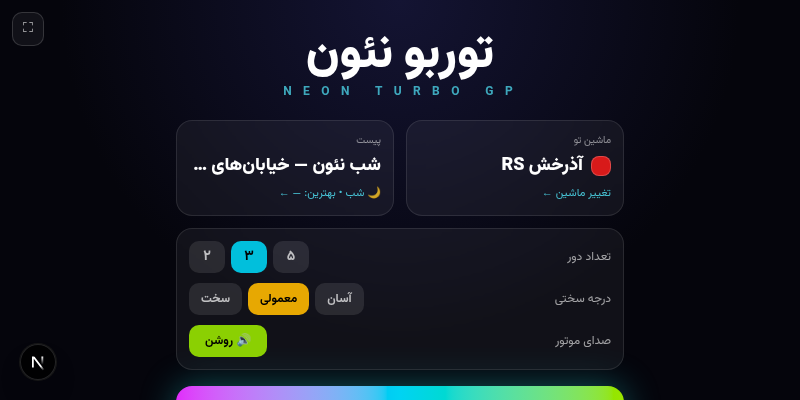
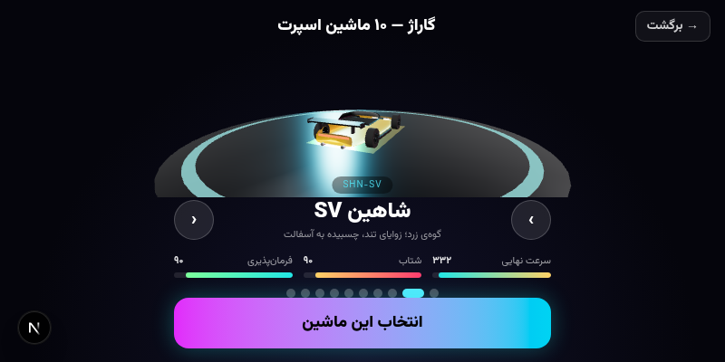
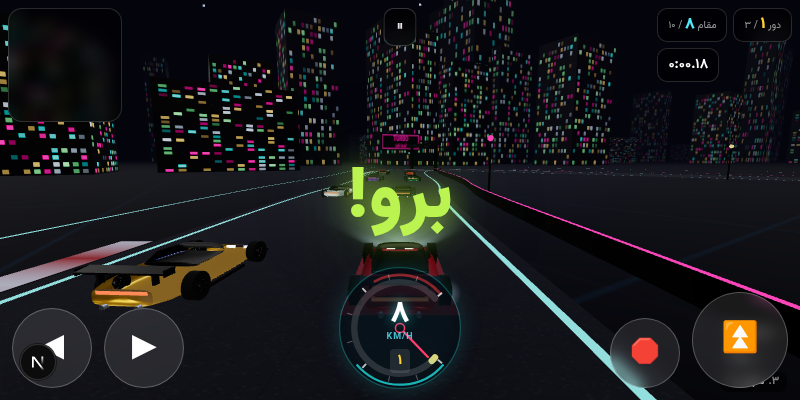
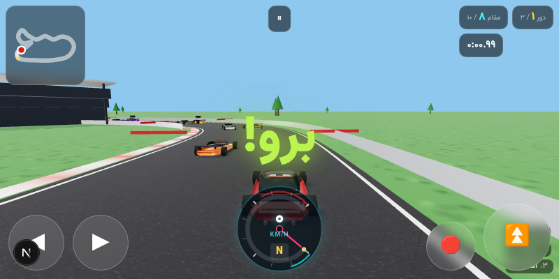
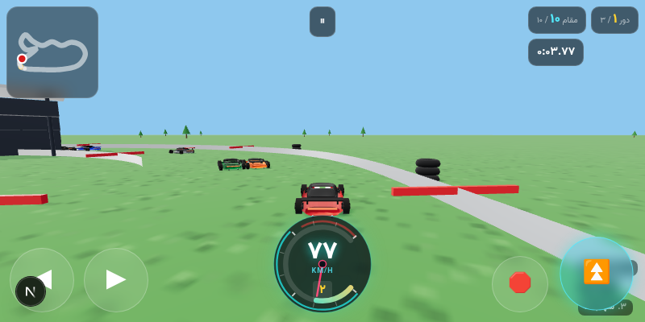

# 🏎️ توربو نئون | Neon Turbo GP

[](https://github.com/peymanm0045-boop/turbo-neon/actions/workflows/build-apk.yml)

> بازی مسابقه‌ای سه‌بعدی با ۱۰ ماشین اسپرت منحصربه‌فرد، ۲ پیست حرفه‌ای و ۹ حریف هوش‌مصنوعی — ساخته‌شده با **Next.js + Three.js** و قابل نصب روی **اندروید** به‌صورت PWA یا APK

<div dir="rtl">

## ✨ امکانات بازی

- 🚗 **۱۰ ماشین اسپرت با ظاهرهای کاملاً متفاوت** — هر ماشین با بدنه، رنگ، اسپویلر و مشخصات فنی منحصربه‌فرد طراحی شده (مدل‌سازی پروسیجرال سه‌بعدی)
- 🌃 **دو پیست حرفه‌ای:**
  - **شب نئون** — خیابان‌های نئونی شهر در شب با آسمان‌خراش‌های نورانی، تونل و جلوه‌های ویژه
  - **پیست بین‌المللی آزادی** — پیست مدرن استاندارد ریسینگ با گران‌استند، چراغ‌های افلاود، کنارگیرها و استقرار لاستیک
- 🤖 **۹ حریف هوش‌مصنوعی** با سطح مهارت متفاوت و قابلیت تعادل‌سازی سرعت (rubber-banding)
- 🕹️ **فیزیک آرکید** با حس دریفت واقعی، برخورد با دیوار و ماشین‌ها، و افکت دوربین سرعتی
- 📱 **کنترل لمسی کامل** برای موبایل + پشتیبانی صفحه‌کلید
- 🗺️ **مینی‌مپ زنده**، رتبه‌بندی لحظه‌ای، شمارش دور و ثبت بهترین زمان
- 🔊 **صدای موتور، لاستیک و برخورد** با WebAudio (بدون فایل صوتی — کاملاً پروسیجرال)
- 📲 **PWA قابل نصب** — تمام‌صفحه، با قابلیت قفل جهت نمایشگر و اجرا روی اندروید

## 🖼️ تصاویر بازی

| منوی اصلی | گاراژ سه‌بعدی |
|:---:|:---:|
|  |  |

| شب نئون — خیابان‌های شهر | پیست بین‌المللی آزادی |
|:---:|:---:|
|  |  |

| کنترل‌های لمسی موبایل |
|:---:|
|  |

## 🚗 ماشین‌ها

| # | ماشین | کد | # | ماشین | کد |
|:-:|:---:|:---:|:-:|:---:|:---:|
| ۱ | آذرخش RS | `AZR-RS` | ۶ | توفان ۱۶ | `TFN-16` |
| ۲ | شاهین SV | `SHN-SV` | ۷ | افعی DB | `AFI-DB` |
| ۳ | سایه GT | `SYH-GT` | ۸ | برق R | `BRQ-R` |
| ۴ | صاعقه P1 | `SQE-P1` | ۹ | مه‌تاب MC | `MHB-MC` |
| ۵ | یخ S | `YKH-S` | ۱۰ | شهاب X | `SHB-X` |

هر ماشین ۴ مشخصه دارد: **سرعت نهایی، شتاب، شاسی و قابلیت دریفت** — ماشین مورد علاقه‌ات را در گاراژ با نمایش چرخشی سه‌بعدی انتخاب کن!

## 🚀 اجرای پروژه

```bash
# نصب وابستگی‌ها
bun install        # یا npm install

# اجرا در حالت توسعه
bun run dev        # یا npm run dev

# ساخت نسخه پروداکشن
bun run build      # یا npm run build
```

سپس مرورگر را روی `http://localhost:3000` باز کنید.

## 📲 نصب روی اندروید (PWA)

1. لینک بازی را با **Google Chrome** روی گوشی اندرویدی باز کنید
2. از منوی کروم (⋮) گزینه **«Add to Home screen»** را بزنید
3. بازی به‌صورت اپلیکیشن تمام‌صفحه روی گوشی شما نصب می‌شود 🎉

## 📦 دانلود فایل APK (خودکار با GitHub Actions)

این ریپو دارای **GitHub Actions workflow** است که با هر تغییر، فایل APK اندروید را به‌صورت خودکار build می‌کند:

1. به تب **[Actions](https://github.com/peymanm0045-boop/turbo-neon/actions)** بروید
2. روی آخرین run موفق **«Build Android APK»** کلیک کنید
3. از بخش **Artifacts** فایل **TurboNeon-APK** را دانلود کنید
4. فایل ZIP دانلودی را باز کنید و `TurboNeon-debug.apk` را روی گوشی نصب کنید (اجازه «نصب از منابع ناشناس» را بدهید)

> 💡 می‌توانید از تب Actions دکمه **«Run workflow»** را بزنید تا دستی APK جدید ساخته شود.
>
> 🏷️ با زدن تگ نسخه (مثلاً `v1.0.0`) فایل APK مستقیماً در بخش **Releases** هم قرار می‌گیرد.

### ویژگی‌های نسخه APK

- ✅ **تمام‌صفحه Immersive** — بدون نوار وضعیت و دکمه‌های ناوبری
- ✅ **قفل افقی** — همیشه در حالت landscape اجرا می‌شود
- ✅ **آفلاین** — بازی کاملاً داخل APK قرار دارد، بدون نیاز به اینترنت
- ✅ آیکون اختصاصی نئونی

### ساخت APK به‌صورت محلی (اختیاری)

```bash
bun install                 # یا npm install
bun run build:static        # خروجی استاتیک در out/
npx cap sync android        # کپی assets به پروژه اندروید
cd android && ./gradlew assembleDebug
# APK: android/app/build/outputs/apk/debug/app-debug.apk
```

> 💡 برای ساخت APK می‌توانید از ابزارهایی مثل [PWABuilder](https://www.pwabuilder.com/) یا [Bubblewrap](https://github.com/GoogleChromeLabs/bubblewrap) هم استفاده کنید — این پروژه کاملاً سازگار با PWA است.

## 🎮 کنترل‌ها

| عملکرد | صفحه‌کلید | لمسی |
|:---:|:---:|:---:|
| فرمان | `←` `→` یا `A` `D` | دکمه‌های چپ/راست |
| گاز | `↑` یا `W` | دکمه گاز (راست پایین) |
| ترمز | `↓` یا `S` | دکمه ترمز (قرمز) |
| توقف/منو | `Esc` یا `P` | دکمه توقف (بالا) |
| قفل چرخش صفحه | `F` | دکمه تمام‌صفحه |

## 🛠️ تکنولوژی‌ها

- **Next.js 16** — فریم‌ورک اصلی (App Router)
- **Three.js 186** — رندر سه‌بعدی WebGL
- **Capacitor 8** — پکیج‌بندی APK اندروید
- **TypeScript** — تایپ‌سیف کامل
- **Tailwind CSS 4 + shadcn/ui** — رابط کاربری
- **WebAudio API** — صدای پروسیجرال
- **PWA** — نصب‌پذیری روی اندروید

## 📁 ساختار پروژه

```
src/
├── game/
│   ├── cars.ts      # ۱۰ ماشین اسپرت (مدل‌سازی + مشخصات)
│   ├── tracks.ts    # ۲ پیست (ساخت هندسه + دکوراسیون)
│   └── engine.ts    # موتور بازی (فیزیک، AI، دور، دوربین، صدا)
├── components/racing/
│   ├── RacingGame.tsx   # ماشین حالت اصلی بازی
│   ├── Hud.tsx          # سرعت‌سنج، کنترل لمسی، توقف/نتایج
│   ├── MenuScreens.tsx  # منوها (فارسی RTL)
│   └── CarPreview.tsx   # شوئ‌روم سه‌بعدی گاراژ
├── app/
│   └── page.tsx     # نقطه ورود بازی
└── .github/workflows/
    └── build-apk.yml    # ساخت خودکار APK اندروید
android/                 # پروژه اندروید (Capacitor)
```

## 📄 لایسنس

MIT — آزاد برای استفاده، تغییر و انتشار.

<div dir="ltr" align="center">

**Made with ❤️ using Next.js + Three.js**

</div>
